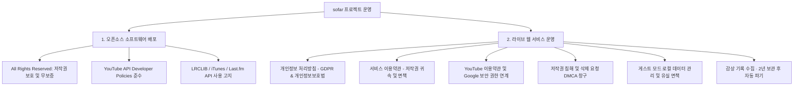

# Legal, Privacy Policy & Terms of Service Guide (법적 고지, 개인정보 처리방침 및 이용약관 가이드)

- **Date**: 2026-11-20
- **Version**: v2.3.0
- **Author**: sofar team

본 문서는 `sofar` 프로젝트를 GitHub 오픈소스로 배포하거나, 실제 독립 도메인에서 웹 서비스로 호스팅하여 운영하고자 하는 개발자 및 운영자를 위한 **법적 고지(Legal Disclaimer), 개인정보 처리방침(Privacy Policy), 서비스 이용약관(Terms of Service), YouTube API 서비스 정책 준수 가이드**입니다.

---

## 1. 법적 체계 개요 (Legal Architecture Overview)



---

## 2. YouTube API Developer Policies 준수 사항

`sofar`는 YouTube의 공식 **IFrame Player API**를 기반으로 오디오를 스트리밍합니다. Google 및 YouTube의 개발자 정책을 위반하지 않기 위해 다음 핵심 수칙을 반드시 준수해야 합니다:

1. **미니 플레이어 상시 렌더링 (`F-POLI-01`)**:
   - YouTube 비디오 스트림을 0px로 숨기거나 투명하게 가리는 행위는 YouTube API 서비스 약관 위반입니다.
   - 본 프로젝트의 `MiniPlayer.jsx`는 최소 규격(240px * 135px)을 준수하여 상시 렌더링되도록 구현되어 있습니다.
2. **미디어 스트림 자체 호스팅/다운로드 금지**:
   - 음원이나 비디오 바이너리를 로컬 서버에 다운로드, 추출(Rip), 재배포하지 않습니다.
3. **YouTube 약관 및 Google 계정 권한 철회 고지 필수**:
   - 서비스 내에 YouTube 이용약관(`https://www.youtube.com/t/terms`) 및 Google 개인정보처리방침(`https://www.google.com/policies/privacy`) 링크를 제공해야 합니다.
   - Google 보안 설정 페이지(`https://security.google.com/settings/security/permissions`)를 통해 사용자가 본 서비스의 계정 권한을 언제든 철회할 수 있음을 명시해야 합니다.

---

## 3. [표준 템플릿] 개인정보 처리방침 (Privacy Policy Template)

> 실제 서비스에 표시되는 원문은 `apps/web/src/pages/LegalPage.jsx`입니다. 이 템플릿은 그 내용을 요약한 것이므로, 원문을 고치면 이 문서도 함께 맞춰 주세요.
> 데이터를 새로 수집하거나 외부 서비스를 추가할 때는 처리 목적(1), 항목(2), 보유 기간(3), 위탁·국외 이전(4)을 반드시 함께 갱신합니다.

```markdown
# [서비스명] 개인정보 처리방침 (Privacy Policy)

**시행일자: 2026년 11월 20일 (v2.3.0)**

### 1. 개인정보의 처리 목적
1. **회원 관리**: 소셜/이메일 계정 기반 본인 식별, 중복 가입 방지, 비인가 부정 이용 방지
2. **서비스 제공**: 플레이리스트 생성 및 다기기 동기화, 프로필 이미지 저장, 가사 오프셋 보관
3. **개인화 추천**: 감상 기록, 즐겨찾기, 플레이리스트에 담은 곡을 바탕으로 한 노래·플레이리스트 추천
4. **통계 및 품질 향상**: 실시간 인기 순위·인기 검색어 집계, 이용 통계, 추천 품질 측정, 음원 일치 여부 피드백 정제, 어뷰징 방지

### 2. 처리하는 개인정보 항목
- **Google 로그인**: 고유 식별자(UUID), 이메일, 프로필 이름, 프로필 이미지 URL
- **이메일 가입**: 이메일, 단방향 해시 비밀번호, 닉네임
- **프로필 수정(선택)**: 직접 올린 프로필 이미지
- **감상 기록(자동)**: 곡 정보(곡명·아티스트·영상 ID), 재생 시작·종료 시각, 실제 재생 시간·곡 길이, 재생 시작 방식(검색·직접 선택·다음 곡 버튼·자동 재생 등)과 재생한 목록, 기기 기준 시간대·요일·시각, 기기 종류, 브라우저 언어
- **추천 이용 기록(자동)**: 표시된 추천 항목과 선택한 항목
- **플레이리스트 반응(회원)**: 좋아요, 응원
- **플레이리스트 조회·공유 기록(자동)**: 연 날짜(하루 1회), 공유 링크 생성과 그 링크로 들어온 방문
- **추천 '관심 없음' 기록**
- **검색 기록(자동)**: 검색어 (최근 일부만 브라우저 식별자와 함께, 나머지는 집계값만)
- **브라우저 식별자**: 감상·검색 기록 구분용 무작위 문자열 (로그인 시 회원 식별자와 함께 기록)
- **로컬 저장소**: 게스트 플레이리스트, 가사 오프셋, 볼륨/테마 설정
- **접속 기록**: IP 주소, 접속 시각 등 (호스팅 인프라 자동 기록)
- 생년월일·성별 등 인적 사항과 금융 정보는 수집하지 않음

### 3. 보유 및 이용 기간
1. 회원 계정 정보: 회원 탈퇴 시까지
2. 감상·추천 이용·조회·공유 유입·응원·관심 없음 기록: 기록일로부터 **2년** 보관 후 매일 자동 파기 (`supabase_listening_events.sql`, `supabase_playlist_signals.sql`의 pg_cron 작업). 좋아요는 취소·탈퇴 시까지
3. 회원 탈퇴 시: 계정, 프로필 이미지, 플레이리스트·수록곡, 즐겨찾기, 감상·추천 기록, 좋아요·응원, 조회·공유 유입, 관심 없음 기록 즉시 영구 삭제 (`apps/api/src/account/account.service.ts`)
4. 비회원 감상 기록: 브라우저 식별자로만 구분, 2년 후 자동 파기
5. 로컬 저장소 데이터: 브라우저 저장 데이터 삭제 시 즉시 소멸

### 4. 처리 위탁 및 국외 이전
- **Supabase Inc.**: DB 호스팅(계정, 플레이리스트, 감상·추천 기록), 인증 세션, 프로필 이미지 저장
- **Render Services, Inc.**: API 서버 운영
- **Vercel Inc.**: 웹 호스팅
- **Google LLC**: YouTube 재생, Google 로그인, 인증 메일 발송(Gmail)
- LRCLIB, iTunes, Last.fm에는 곡명·아티스트명만 전송 (이용자 식별 정보 미전송)

### 5. 이용자의 권리
1. 개인정보 열람, 닉네임/프로필 수정, 감상 기록 삭제, 회원 탈퇴를 통한 삭제 요구
2. [Google 보안 설정 페이지](https://security.google.com/settings/security/permissions)에서 연동 철회
3. 기타 권리 행사는 개인정보 보호책임자 이메일로 요청

### 6. 쿠키 및 로컬 스토리지
- 로그인 세션, 게스트 보관함, UI 설정, 브라우저 식별자 저장에 Local Storage 사용

### 7. 안전성 확보 조치
- 비밀번호 단방향 암호화, HTTPS, RLS 접근 격리 (감상·추천 기록은 서버만 기록, 본인만 조회)

### 8. 개인정보 보호책임자
- **문의 이메일**: [support@yourdomain.com]

### 9. 변경 이력
- v2.3.0 (2026-11-20): 플레이리스트 좋아요·응원·조회·공유 유입, 관심 없음 기록 추가
- v2.2.0 (2026-11-20): 감상·추천·검색 기록, 2년 보관, 개인화 추천, 위탁 사업자(Render, Vercel, Gmail) 및 국외 이전 추가
- v2.1.0 (2026-08-19): 이전 버전
```

---

## 4. [표준 템플릿] 서비스 이용약관 (Terms of Service Template)

> 실제 서비스에 표시되는 원문은 `apps/web/src/pages/LegalPage.jsx`입니다.

```markdown
# [서비스명] 서비스 이용약관 (Terms of Service)

**시행일자: 2026년 11월 20일 (v2.3.0)**

**제1조 (목적)** 서비스 이용과 관련한 회사와 이용자 간의 권리, 의무 및 책임사항 규정

**제2조 (외부 서비스 약관 및 정책의 준용)**
1. YouTube IFrame Player API로 미디어를 재생합니다.
2. [YouTube 서비스 약관](https://www.youtube.com/t/terms) 및 [Google 개인정보 보호정책](https://www.google.com/policies/privacy)을 준용합니다.
3. [Google 보안 설정 페이지](https://security.google.com/settings/security/permissions)에서 권한을 철회할 수 있습니다.

**제3조 (지식재산권 및 콘텐츠 정책)** 저작권은 원저작자·유통사·크리에이터에게 귀속, 음원·영상 다운로드/재배포 없음, 가사·곡 정보·비슷한 곡 정보는 LRCLIB·iTunes·Last.fm 등 공개 API 활용

**제4조 (금지행위)** 자동화 스크립트·봇 남용, YouTube 플레이어 은폐·변조, 음원 일치 피드백 허위·반복 제출, 반복 재생·검색으로 순위·인기 검색어·추천 조작, 다중 계정·자동화로 좋아요·응원·조회·공유 유입 부풀리기, 계정 도용, 무단 재배포

**제5조 (게스트 모드 및 데이터 관리)** 게스트 데이터는 Local Storage에만 보관, 유실 시 복구 책임 없음

**제6조 (개인화 추천, 순위 및 공개 플레이리스트)**
1. 감상 기록·즐겨찾기·플레이리스트를 바탕으로 추천하며 정확성은 보장하지 않음
2. 실시간 순위·인기 검색어는 개인을 알아볼 수 없는 집계로 제공
3. 공개 플레이리스트는 다른 이용자의 추천 목록에 작성자 이름·직접 올린 프로필 이미지와 함께 노출될 수 있음 (익명 표시 시 미표시)
4. 비공개로 바꾸면 노출 중단
5. 회원은 좋아요·응원 가능 (합계만 표시, 누가 눌렀는지는 비공개). 응원은 가입 3일 이상·이메일 인증 계정, 주 3회
6. 부정한 반응은 집계에서 제외하거나 이용 제한 가능

**제7조 (사용자 피드백 및 기여 데이터)** 음원 일치 여부 피드백, 가사 오프셋 보정값 등은 품질 향상에 비독점적으로 활용

**제8조 (면책 및 서비스 변경·중단)** 외부 플랫폼 장애·정책 변경 면책, 점검 등 사유로 사전(긴급 시 사후) 공지 후 변경·중단

**제9조 (저작권 침해 신고, DMCA)** [support@yourdomain.com]으로 접수, 확인 즉시 노출 차단

**제10조 (준거법 및 관할)** 대한민국 법률, 민사소송법상 관할법원
```

---

## 5. 오픈소스 리포지토리 체크리스트 (Summary Checklist)

- [x] **루트 LICENSE 생성**: All Rights Reserved 저작권 보호 및 포트폴리오 열람 허용 라이선스 탑재 완료
- [x] **README.md 내 Disclaimer 기재**: YouTube API 약관 및 저작권 귀속 공지 완료
- [x] **환경변수 분리**: `.env.example` 템플릿만 커밋하고 실제 비밀 키는 `.gitignore`로 완벽 차단
- [x] **보안 취약점 신고 채널 제공**: `SECURITY.md` 탑재 완료
- [x] **실제 배포자를 위한 가이드 제공**: 본 `docs/legal-privacy-policy-guide.md` 제공

